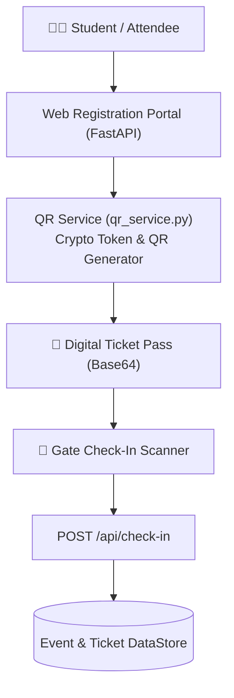

# 🎟️ Prime Event & QR Ticket Management System

A high-performance event registration and cryptographic digital QR ticket verification platform designed for **Prime IT Club** campus workshops, hackathons, and technical bootcamps.

Developed by **[Samyog](https://github.com/hola-mundo999)** · *Backend Engineering & API Design*.

---

## 🌟 Key Features

1. **High-Speed REST API:**
   - Engineered with **FastAPI** and **Pydantic** validation for low-latency registration processing and event querying.
2. **Dynamic Digital QR Pass Generation:**
   - Generates high-contrast digital QR passes embedded with cryptographic verification tokens using `qrcode` and `Pillow`.
   - Returns client-ready Base64 image data URIs with instant one-click download.
3. **Gate Check-In & Scanner Terminal:**
   - Dedicated verification terminal for event coordinators to check in attendees and prevent duplicate entries.
4. **Attendance Analytics:**
   - Real-time RSVP metrics, check-in percentage tracking, and attendee roster logs.
5. **Modern Glassmorphic UI:**
   - Responsive dark-mode single-page interface styled with **Tailwind CSS**.

---

## 🏗️ System Architecture



---

## 🛠️ Tech Stack

- **Backend:** [FastAPI](https://fastapi.tiangolo.com/), [Uvicorn](https://www.uvicorn.org/)
- **Data Validation & Models:** [Pydantic v2](https://docs.pydantic.dev/)
- **QR Imaging:** `qrcode`, `Pillow`
- **Frontend:** HTML5, Tailwind CSS, Vanilla JS
- **Version Control:** Git & GitHub

---

## 🚀 Getting Started

### 1. Clone the repository
```bash
git clone https://github.com/hola-mundo999/prime-event-ticket-manager.git
cd prime-event-ticket-manager
```

### 2. Set up virtual environment
```bash
python -m venv venv
venv\Scripts\activate   # Windows
```

### 3. Install dependencies
```bash
pip install -r requirements.txt
```

### 4. Run the application
```bash
uvicorn main:app --reload --port 8000
```

Open `http://localhost:8000` to access the web portal, or `http://localhost:8000/docs` to inspect the auto-generated Swagger API documentation.

---

## 🌐 Deployment (Render)

This service is configured for [Render](https://render.com/) via `render.yaml`.

- **Build command:** `pip install -r requirements.txt`
- **Start command:** `uvicorn main:app --host 0.0.0.0 --port $PORT`
- **Database:** SQLite file `event_tickets.db` (created on first run; persists on Render's persistent disk if enabled).

Create a new "Web Service" on Render, connect this repository, and set the start command above. The `event_tickets.db` file is gitignored and created automatically at runtime.

---

## 🧪 Testing

```bash
pip install -r requirements.txt
pytest
```

The test suite (13 tests) covers event listing, registration validation, duplicate prevention, capacity limits, check-in/check-in-duplicate handling, stats, and CSV export.

---

## 📜 License
MIT License — Free to use, adapt, and build upon.
